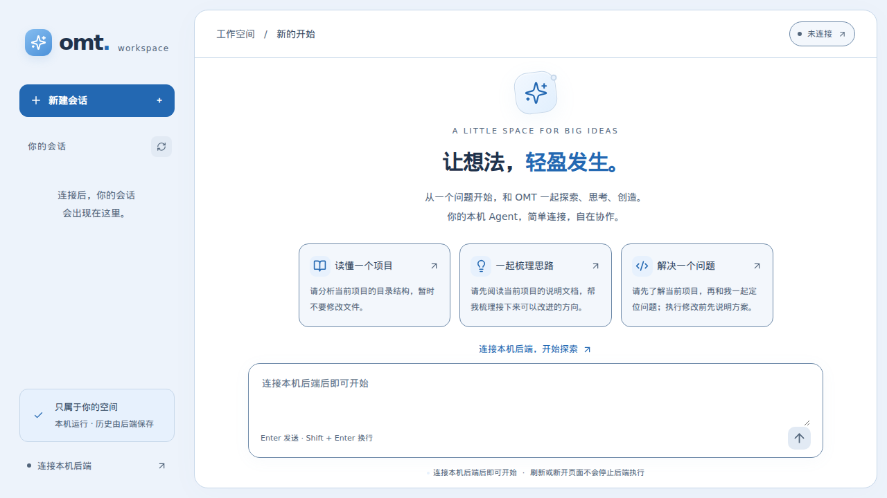

# OMT Frontend

一个基于 **Next.js + TypeScript** 的本机 Agent 前端。浅蓝色界面，提供会话管理、Markdown 消息、工具记录和明确的执行反馈。



[查看窄屏界面](docs/images/workspace-mobile.png)

> 第一版只面向可信本机、单用户环境。不是面向公网的部署方案，也不包含独立的模型后端。

## 环境

- Node.js **22.19+**（建议使用 Node.js 22 LTS 或更新的受支持 LTS）
- npm，依赖使用 `package-lock.json` 锁定
- 已配置并运行的 omt-agent HTTP 后端，默认地址 `http://127.0.0.1:8000`
- 后端操作者提供的访问令牌：不是模型 API Key

后端接口和操作限制见 [前端接入契约](docs/frontend-api.md)。其中指向后端配置、源码和测试的链接属于后端仓库，不一定存在于本项目。

## 开发启动

```bash
npm ci
cp .env.example .env.local
npm run dev
```

打开 **http://127.0.0.1:3000**。

默认配置已指向本机 8000 端口；只有需要修改后端端口时才编辑 `.env.local`：

```dotenv
OMT_BACKEND_URL=http://127.0.0.1:8000
```

这是服务端配置，修改后重启 Next.js。只允许本机回环 HTTP(S) origin，不支持带路径、用户名或密码的地址。不要添加保存令牌的 `NEXT_PUBLIC_*` 变量。

1. 点击右上角“未连接”或“连接本机后端”。
2. 输入访问令牌，前端通过会话列表接口验证认证。
3. 新建会话（标题可选），或选择已有会话。
4. 输入消息，Enter 发送；Shift + Enter 换行。
5. 等待最终结果，再查看回答及可折叠的工具调用和结果。

令牌仅保存在页面内存，**刷新后重新输入**。会话历史保存在后端，重新连接后仍可读取。断开连接会清除本页面缓存和草稿，但不会删除后端会话。

## 本机生产模式

```bash
npm run build
npm start
```

开发及生产启动命令默认只监听 `127.0.0.1`，请勿自行绑定公网地址。需要换端口时：

```bash
npm run dev -- --port 3001
# 或
npm start -- --port 3001
```

浏览器调用 `/api/omt/*`，Next.js 将白名单接口转发到固定的本机后端，不要求浏览器直连跨域端口。代理不会将 Cookie 转发到后端，不跟随重定向，不自动重试 POST，并允许长时间等待执行响应。

## 已实现

- 内存令牌、连接验证、断开与认证失效提示。
- 新建会话、会话列表、会话切换、手动刷新。
- 用户 / 助手 / 工具历史，Markdown、GFM 表格和代码块。
- 工具参数和结果折叠展示；有调用 ID 时可跳转到对应调用。
- 当前消息输入、等待状态、同步提交锁和会话响应隔离。
- 非致命警告、错误诊断 ID、结果不明与人工检查流程。
- 执行成功后刷新历史和列表，刷新失败时保留最终回答。
- 浅蓝色背景、深蓝灰文字的响应式布局，关键文字对比度回归测试，以及原生模态框和键盘输入支持。

## 必须了解的执行语义

- 后端为**非流式**接口，等待期间没有 token 流或真实工具进度。
- 一次执行可能读写文件或运行命令。网络断开、超时和页面关闭都不代表后端已停止或已回滚。
- 发送和创建均无自动重试。创建响应丢失时，先关闭弹窗并刷新列表检查，避免重复创建。
- 默认后端全局只接受一轮执行。本页面执行期间禁用新的本地发送；其他页面或客户端仍可能造成 busy / 容量拒绝。
- 执行结果不明时，本页面阻止继续发送。可以手动读取历史并人工检查，再明确确认允许继续。**历史可读并不能证明某次丢失响应的请求是否执行过。** 也可以在连接设置中主动断开，但会丢失本页跟踪信息，不会停止后端。
- 运行成功但历史刷新失败不是运行失败；重新读取历史不会重新执行消息。
- 后端不支持停止、删除、重命名、附件上传、模型选择或运行状态查询，本项目不会伪造这些能力。
- 消息和工具内容可能包含敏感信息。原始 HTML 不渲染，Markdown 外部图片不自动加载；仍应谨慎打开外链。

## 测试与质量检查

```bash
npm run typecheck
npm run lint
npm test
npm run build
npm run test:proxy
```

`test:proxy` 在随机本机端口启动独立 HTTP 替身及已构建的 Next.js，验证真实代理路由、同源 POST、认证与路径转发；结束后关闭服务，不连接真实后端。

浏览器测试首次运行前安装 Chromium：

```bash
npx playwright install chromium
npm run build
npm run test:e2e
```

Playwright 使用 3100 端口启动生产构建，测试结束会关闭服务。测试全部采用 mock / 替身，不需要真实令牌，不会调用模型或执行真实后端工具。

部分精简 Linux 环境需要额外的浏览器系统依赖，例如 `libasound.so.2`。可先运行 `npx playwright install-deps --dry-run chromium` 查看缺失依赖，再由操作者决定是否授权安装；本项目脚本不会自动提权安装系统软件。中文截图还需要系统具备中文字体。

测试分层：
- API：请求契约、认证、路径编码、响应校验、错误及禁止重试。
- 控制器：创建/发送锁、异步竞态、连接隔离、历史替换及异常恢复。
- React + MSW：从输入令牌到发送展示的集成流程，Markdown 安全展示。
- 代理冒烟测试：构建后的真实 Next.js 路由接入隔离的本机 HTTP 替身，覆盖 Next 内部 URL 与浏览器 Host 的差异。
- Playwright：真实浏览器中的桌面/窄屏布局、完整交互、内存令牌生命周期和结果不明流程。

## 代码与扩展

先阅读 [架构文档](docs/architecture.md)，再阅读对应代码：

| 路径 | 职责 |
| --- | --- |
| `src/app/` | Next.js 页面、全局样式和代理路由 |
| `src/lib/omt-api/` | 类型契约、Zod 校验、HTTP 客户端和错误 |
| `src/lib/server/` | 固定本机上游代理 |
| `src/features/workspace/model/` | 状态、操作及竞态处理，不依赖 React |
| `src/features/workspace/components/` | 展示与交互，不直接请求后端 |
| `src/features/connection/` | 连接与令牌输入界面 |
| `src/components/ui/` | 通用界面模块 |
| `tests/e2e/` | 浏览器流程测试 |

新增接口先扩展契约、schema 和客户端，再接入功能及 UI。后续增加令牌持久化、流式输出或多用户功能时，先明确新的安全及后端契约，不直接绕过当前模块。

项目协作规范见 [AGENTS.md](AGENTS.md)。未经用户允许不提交或推送 Git。
