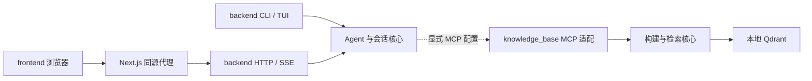

# 整体架构

本仓库统一 Git、文档与开发入口，三个模块保留独立的依赖和运行入口。

## 模块与依赖

- `backend/`：Python `omt` 包，包含 CLI、HTTP API 与共用核心。默认 MCP 配置为空，不导入或定位 knowledge_base 的内部代码。
- `knowledge_base/`：Python `rag_mcp` 包，具备资料构建、检索、评估及 stdio MCP 入口，可单独安装和运行。包名和命令保留，目录名不代表 Python 导入名。
- `frontend/`：Next.js + TypeScript，浏览器访问本机 Next.js 同源代理，再转发到 backend；浏览器不直接连接知识库。
- `scripts/`：Bash 负责项目定位和入口转发，Python 标准库负责 Web 进程生命周期与插件配置生成。

Python 项目各有一份 uv.lock，前端沿用 package-lock.json；共享 Git 不要求合并运行环境。CI 从根 `.github/workflows/` 执行各模块检查。

## 启动、配置与存储

CLI/API 使用 `uv run --project` 选择安装位置，保留调用者 cwd；工具范围和会话归属仍基于实际 cwd。Next.js 在 frontend 目录启动。Web 脚本检查两个端口后启动单 worker API，只以 `/health` 确认存活，再启动前端；模型配置未就绪不阻止打开配置页面。

Web 脚本为 Next.js 注入与本次 API 端口一致的 OMT_BACKEND_URL，覆盖本次进程继承的同名配置；独立运行 Next.js 时仍遵循 frontend/.env.local。启动失败、子进程退出、SIGINT、SIGTERM 或终端关闭的 SIGHUP 均触发对本次创建的 API/Web 进程组的清理。

模型认证、默认模型与会话库继续使用 `~/.omt`，迁移不改写用户数据，也不改变已有会话按工作目录归属的规则。不同进程的会话互斥仍不是跨进程锁，CLI/API 不应并发继续同一会话。

## 可选插件

通过 OMT_CLI_MCP_SERVERS 或 OMT_API_MCP_SERVERS 显式启用，两个配置互不继承。配置生成脚本只输出 JSON，不创建目录、数据库或请求模型；未指定构建开关时只读使用已有资料库。

当前知识库仍采用 stdio，backend 的 MCP 客户端负责启动和关闭子进程。两个进程不能同时打开同一 Qdrant 本地目录；同时启用 CLI/API 插件时应分别指定数据库目录，独立构建。Streamable HTTP 共享知识库进程属于后续扩展，本次没有新增该传输。

模块细节见 [后端架构](omt/architecture.md)、[前端架构](frontend/architecture.md)、[知识库架构](knowledge_base/architecture.md)。接口的唯一权威来源是 [前后端契约](omt/frontend-api.md)。
